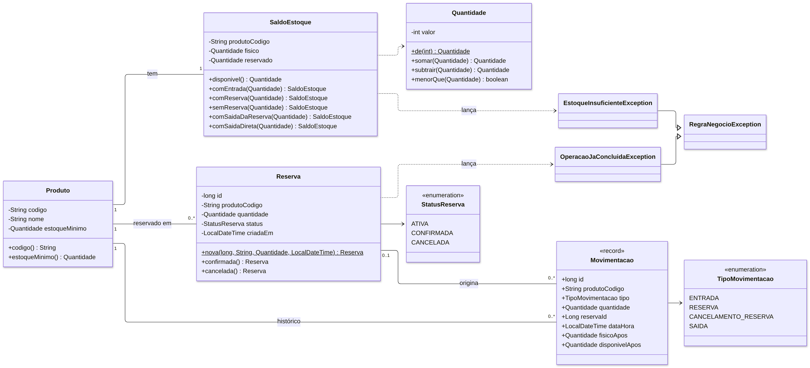
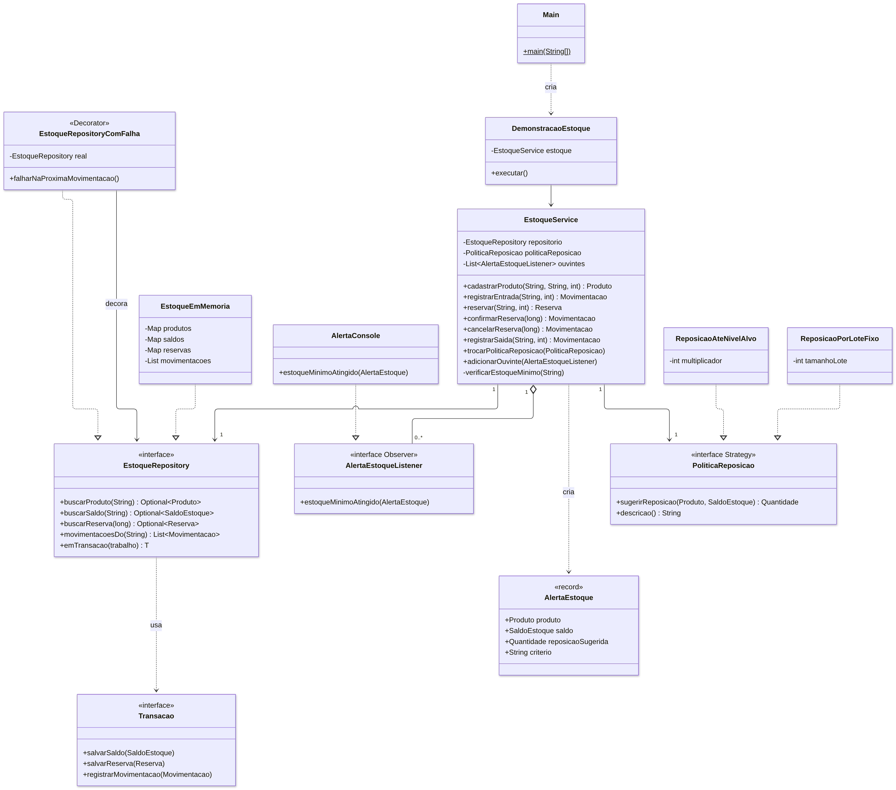

# Gerenciamento de Estoque (Flow PDV)

**Universidade Federal da Paraíba | Campus IV**
Ciência da Computação e Sistemas de Informação
Disciplina: Análise e Projeto de Sistemas (2026.2)
Professor: Dr. Dorgival Netto

## Identificação da equipe

* **Equipe:** Grupo 01
* **Projeto:** Gerenciamento de Estoque
* **Repositório:** https://github.com/jpablopng/aps-gerenciamento-estoque
* **Branch principal:** `main`

| Nome completo | E-mail institucional | Usuário GitHub | Link do perfil |
|---|---|---|---|
| João Pablo da Silva | joao.pablo@dcx.ufpb.br | @jpablopng | https://github.com/jpablopng |
| Luigi Truglio Amarante Chaves | luigi.truglio@dcx.ufpb.br | @luigidcx | https://github.com/luigidcx |
| Alex Renovato | alex.renovato@dcx.ufpb.br | @AlexRenovato | https://github.com/AlexRenovato |
| Pedro Filho |  pedro.fernandes@dcx.ufpb.brr | @PedroFernandes-fa | https://github.com/PedroFernandes-fa |

## Objetivo do sistema

Sistema de caixa e controle de estoque (Flow PDV) para a InforTech Tecnologia, loja física de
eletrônicos e itens colecionáveis operada pelo proprietário e pelo filho. O aplicativo atual trava
e dá erro ao registrar mercadorias e vendas, o estoque não bate e o faturamento é calculado na mão.

A primeira versão cobre o ciclo básico: cadastrar produtos, dar entrada de mercadorias, registrar
vendas com a forma de pagamento (incluindo QR Code Pix com o valor da compra), baixar o estoque
automaticamente, alertar quando um produto chega no estoque mínimo e mostrar o faturamento do dia.

## Origem dos requisitos

* **Documentação anterior** (projeto de Modelagem de Dados, no Notion "Flow Dev's"):
  * Entrevista com o cliente, Fábio Henrique Mesquita Urbano
  * Documento de Requisitos, revisão 13 (21/07/2026): US01 a US20, RN01 a RN07, RNF01 a RNF05, UC01 Registrar Venda
  * Backlog do Produto com critérios de aceite
* **O que foi revisto ou adaptado:**
  * O MVP ficou com as histórias de prioridade alta (US01 a US07) mais a US09 (forma de pagamento), que a venda precisa. US04 (mensagens de erro claras) é tratada como requisito de qualidade em todos os casos de uso.
  * **Perfis:** na entrevista o cliente disse que não precisa de níveis de acesso, porque só ele e o pai operam o caixa. O sistema tem um único ator, o Operador de Caixa, com login apenas para registrar quem fez cada venda (US14). O ator "Admin" do diagrama de casos de uso não foi implementado.
  * **Pix:** o cliente quer o QR Code gerado na hora com o valor da compra. Nesta versão o sistema gera o código Pix com o valor e o operador confirma o recebimento. A confirmação automática via API (fluxo alternativo do UC01) fica para a próxima versão ([ADR 003](docs/adr/003-padroes-de-projeto.md)).
  * **Cartão:** o cliente passa o cartão na maquininha; o sistema só registra se foi débito ou crédito.
  * **Cancelamento de venda (US18, RN05) e nota fiscal (US17):** fora do MVP.
  * Foram acrescentadas as regras RN08 a RN10, que estavam implícitas no UC01 e na entrevista.

## Escopo implementado

### Casos de uso

| Caso de uso | Histórias | Resumo |
|---|---|---|
| UC01 Registrar venda | US02, US03, US09, US14 | Adiciona itens, escolhe a forma de pagamento, confirma, baixa o estoque, atualiza o faturamento e dispara o alerta de mínimo |
| UC02 Cadastrar produto | US01 | Cadastra e edita produto com nome, marca, categoria, preço, quantidade e estoque mínimo |
| UC03 Registrar entrada de mercadoria | US06 | Soma a quantidade recebida ao estoque do produto |
| UC04 Consultar faturamento do dia | US05 | Mostra o total das vendas confirmadas no dia |

O alerta de estoque mínimo (US07) acontece dentro do UC01, quando a baixa deixa o produto no limite.

### Regras de negócio

| Regra | Descrição | No MVP? |
|---|---|---|
| RN01 | Todos os campos obrigatórios do cadastro de produto devem ser preenchidos (nome, marca, categoria, preço e quantidade) | Sim |
| RN02 | É proibido cadastrar produto duplicado (mesmo nome e marca) | Sim |
| RN03 | O estoque nunca pode ter quantidade negativa | Sim |
| RN04 | A quantidade em estoque é reduzida automaticamente logo após a confirmação da venda | Sim |
| RN05 | No cancelamento da venda, estornar a cobrança, devolver os itens ao estoque e deduzir do faturamento | Não |
| RN06 | O faturamento diário é atualizado a cada venda confirmada | Sim |
| RN07 | O sistema alerta quando um produto atinge o estoque mínimo configurado | Sim |
| RN08 | Um item só entra na venda se houver estoque suficiente (fluxo de exceção do UC01) | Sim (nova) |
| RN09 | A entrada de mercadoria soma a quantidade ao estoque do produto | Sim (nova) |
| RN10 | Toda venda registra quem vendeu, o que foi vendido e a forma de pagamento | Sim (nova) |

## Diagrama de classes

