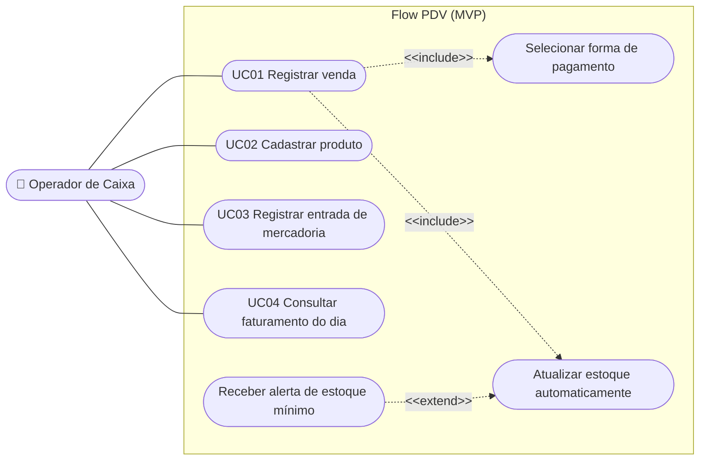

# Casos de uso

Subsistema: Flow PDV. Modelo de descrição completa igual ao do Documento de Requisitos (revisão 13).
O UC01 parte da descrição que já existia no documento, ajustada ao escopo do MVP; UC02 a UC04 são novos.

## Ator

| Ator | Descrição |
|---|---|
| Operador de Caixa | Usuário do sistema (o proprietário ou o filho). Cadastra produtos, dá entrada de mercadorias, registra vendas e consulta o faturamento. Na entrevista o cliente disse que não precisa de níveis de acesso, então há um ator só. |

## Diagrama

Casos de uso do diagrama original que ficam fora do MVP: Cadastrar categoria, Pesquisar produto,
Visualizar relatório por período, Consultar histórico de vendas, Visualizar painel inicial,
Visualizar histórico de alterações, Visualizar o autor da venda (como tela própria), Cancelar venda,
Emitir nota fiscal e Visualizar produtos mais vendidos.

---

## UC01 Registrar venda

**Histórias:** US02, US03, US07, US09, US14
**Regras:** RN03, RN04, RN06, RN07, RN08, RN10

**Descrição sucinta:** o Operador de Caixa adiciona os produtos que o cliente vai levar, o sistema
calcula o total, o operador escolhe a forma de pagamento (com QR Code Pix gerado com o valor da
compra) e confirma. O sistema registra a venda, baixa o estoque e atualiza o faturamento do dia.

**Pré-condições:** o operador está logado. Os produtos estão cadastrados.

**Pós-condições:** a venda fica gravada com operador, itens, total e forma de pagamento (RN10).
O estoque de cada item foi reduzido (RN04) e o faturamento do dia inclui a venda (RN06).

### Fluxo principal: Realizar venda padrão

1. O operador inicia uma nova venda.
2. O operador digita o nome do produto e o seleciona.
3. O operador informa a quantidade.
4. O sistema confere o estoque (RN08), adiciona o item à venda com o preço atual e atualiza o subtotal.
5. O operador repete os passos 2 a 4 até incluir todos os itens.
6. O operador escolhe finalizar a venda.
7. O sistema mostra o total e pede a forma de pagamento.
8. O operador escolhe Dinheiro, Débito ou Crédito e confirma.
9. O sistema grava a venda, baixa o estoque de cada item numa única transação (RN04) e atualiza o faturamento do dia (RN06).
10. O sistema mostra a confirmação da venda com o total e a forma de pagamento.

### Fluxos alternativos

| Fluxo relacionado | Variante | Descrição |
|---|---|---|
| Realizar venda padrão | Passo 8: pagamento em Pix | 1. O operador escolhe Pix. 2. O sistema gera o código Pix com o valor exato da venda e o mostra como QR Code. 3. O cliente lê o código e paga pelo celular. 4. O operador confere que o pagamento caiu e confirma. 5. Volta ao passo 9. |
| Realizar venda padrão | Passo 8: pagamento em dinheiro | 1. O operador informa o valor recebido. 2. O sistema mostra o troco. 3. Volta ao passo 9. |
| Realizar venda padrão | Passo 9: produto chega ao estoque mínimo | 1. Depois da baixa, o sistema verifica cada item. 2. Se a quantidade ficou igual ou abaixo do estoque mínimo, o sistema mostra um alerta com o nome do produto e a quantidade restante (RN07). 3. Volta ao passo 10. |
| Realizar venda padrão | Passo 5: remover item | 1. O operador escolhe um item já adicionado e o remove. 2. O sistema atualiza o subtotal. 3. Volta ao passo 5. |

### Fluxos de exceção

| Fluxo relacionado | Condição | Descrição |
|---|---|---|
| Realizar venda padrão | Passo 4: produto sem estoque suficiente | 1. O sistema identifica que a quantidade pedida é maior que o estoque. 2. Mostra uma mensagem clara: o produto, quanto tem em estoque e que a quantidade precisa ser menor ou igual a isso. 3. O item não entra na venda. 4. Volta ao passo 2. |
| Realizar venda padrão | Passo 3: quantidade inválida | 1. O operador informa zero, número negativo ou texto. 2. O sistema avisa que a quantidade deve ser um número inteiro maior que zero. 3. Volta ao passo 3. |
| Realizar venda padrão | Passo 6: venda sem itens | 1. O sistema avisa que a venda precisa de pelo menos um item. 2. Volta ao passo 2. |
| Realizar venda padrão | Passo 9: falha ao gravar | 1. O sistema desfaz toda a operação: nem a venda nem a baixa ficam gravadas. 2. Mostra a mensagem de erro com a causa. 3. A venda continua aberta para tentar de novo. |

---

## UC02 Cadastrar produto

**Histórias:** US01
**Regras:** RN01, RN02, RN03

**Descrição sucinta:** o Operador de Caixa cadastra um produto novo ou edita um existente, informando
nome, marca, categoria, preço, quantidade e estoque mínimo.

**Pré-condições:** o operador está logado.

**Pós-condições:** o produto fica gravado e disponível para venda e entrada de mercadoria.

### Fluxo principal: Cadastrar produto novo

1. O operador escolhe cadastrar produto.
2. O sistema pede nome, marca, categoria, preço, quantidade inicial e estoque mínimo.
3. O operador preenche e confirma.
4. O sistema valida os campos obrigatórios (RN01), confere se já existe produto com o mesmo nome e marca (RN02) e se as quantidades não são negativas (RN03).
5. O sistema grava o produto e mostra a mensagem de sucesso.

### Fluxos alternativos

| Fluxo relacionado | Variante | Descrição |
|---|---|---|
| Cadastrar produto novo | Passo 1: editar produto | 1. O operador escolhe editar e seleciona o produto pelo nome. 2. O sistema mostra os dados atuais. 3. O operador altera o que precisa. 4. Segue do passo 4, sem acusar duplicidade com o próprio produto. |

### Fluxos de exceção

| Fluxo relacionado | Condição | Descrição |
|---|---|---|
| Cadastrar produto novo | Passo 4: campo obrigatório vazio | 1. O sistema diz qual campo falta. 2. Volta ao passo 3 com os outros campos mantidos. |
| Cadastrar produto novo | Passo 4: produto duplicado | 1. O sistema avisa que já existe um produto com esse nome e essa marca e sugere editar o existente. 2. Volta ao passo 3. |
| Cadastrar produto novo | Passo 4: valor inválido | 1. Preço menor ou igual a zero, ou quantidade negativa. 2. O sistema diz qual valor está errado e o que é aceito. 3. Volta ao passo 3. |

---

## UC03 Registrar entrada de mercadoria

**Histórias:** US06
**Regras:** RN03, RN09

**Descrição sucinta:** quando chega mercadoria, o Operador de Caixa registra a quantidade recebida
e o sistema soma ao estoque do produto.

**Pré-condições:** o operador está logado. O produto está cadastrado.

**Pós-condições:** a entrada fica gravada com data, quantidade e operador, e o estoque do produto aumentou (RN09).

### Fluxo principal: Registrar entrada

1. O operador escolhe registrar entrada.
2. O operador digita o nome do produto e o seleciona.
3. O sistema mostra a quantidade atual em estoque.
4. O operador informa a quantidade recebida e confirma.
5. O sistema grava a entrada e soma a quantidade ao estoque (RN09).
6. O sistema mostra a nova quantidade em estoque.

### Fluxos de exceção

| Fluxo relacionado | Condição | Descrição |
|---|---|---|
| Registrar entrada | Passo 2: produto não encontrado | 1. O sistema avisa que o produto não está cadastrado e indica o UC02. 2. Volta ao passo 2. |
| Registrar entrada | Passo 4: quantidade inválida | 1. Zero, negativo ou texto. 2. O sistema avisa que a quantidade deve ser um inteiro maior que zero. 3. Volta ao passo 4. |

---

## UC04 Consultar faturamento do dia

**Histórias:** US05
**Regras:** RN06

**Descrição sucinta:** o Operador de Caixa consulta quanto a loja vendeu no dia, sem fazer conta na mão.

**Pré-condições:** o operador está logado.

**Pós-condições:** nenhuma alteração nos dados.

### Fluxo principal: Consultar faturamento

1. O operador escolhe consultar o faturamento do dia.
2. O sistema soma as vendas confirmadas da data atual (RN06).
3. O sistema mostra o total faturado, a quantidade de vendas e o total por forma de pagamento.

### Fluxos alternativos

| Fluxo relacionado | Variante | Descrição |
|---|---|---|
| Consultar faturamento | Passo 2: nenhuma venda no dia | 1. O sistema mostra faturamento zero e a mensagem de que ainda não houve vendas hoje. |
