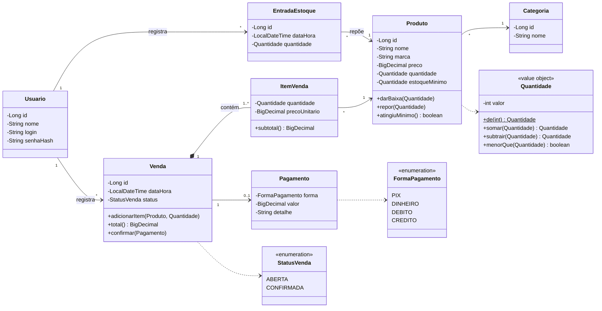

# Diagrama de classes

Fonte em Mermaid, renderizado direto pelo GitHub. Para exportar como imagem, cole o bloco em
https://mermaid.live e baixe em PNG ou SVG, salvando nesta pasta como `diagrama-dominio.png` e `diagrama-camadas.png`.

## 1. Domínio (`model`)

A `Venda` é o centro: liga quem vendeu, os itens, os produtos e o pagamento.

| Relacionamento | Tipo | Leitura |
|---|---|---|
| Usuario 1 : * Venda | Associação | Cada venda guarda quem vendeu (RN10, US14) |
| Venda 1 : 1..* ItemVenda | Composição | O item só existe dentro da venda |
| ItemVenda * : 1 Produto | Associação | O item guarda o preço da hora da venda, então mudar o preço do produto não altera vendas antigas |
| Venda 1 : 0..1 Pagamento | Associação | A venda aberta ainda não tem pagamento; a confirmada tem um |
| Produto * : 1 Categoria | Associação | Cada produto tem uma categoria (RN01) |
| EntradaEstoque * : 1 Produto | Associação | Cada entrada repõe um produto (RN09) |
| Usuario 1 : * EntradaEstoque | Associação | Registra quem deu a entrada |

## 2. Camadas e padrões (`controller`, `service`, `repository`)

```mermaid
classDiagram
    direction TB

    class ConsoleController {
        +executar()
    }

    class ProdutoService {
        +cadastrar(nome, marca, categoria, preco, quantidade, estoqueMinimo) Produto
        +editar(Produto)
    }

    class VendaService {
        +iniciarVenda(Usuario) Venda
        +adicionarItem(Venda, Long produtoId, int quantidade)
        +confirmar(Venda, MeioPagamento)
    }

    class EstoqueService {
        +registrarEntrada(Long produtoId, int quantidade, Usuario)
        +darBaixa(Venda)
        +adicionarListener(AlertaEstoqueListener)
    }

    class FaturamentoService {
        +faturamentoDoDia(LocalDate) BigDecimal
    }

    class RegraNegocioException {
        -String causa
        -String solucao
    }

    class MeioPagamento {
        <<interface>>
        +processar(Venda) Pagamento
    }
    class PagamentoPix {
        +gerarCodigoPix(BigDecimal) String
    }
    class PagamentoDinheiro {
        +calcularTroco(BigDecimal) BigDecimal
    }
    class PagamentoCartao

    class AlertaEstoqueListener {
        <<interface>>
        +estoqueMinimoAtingido(Produto)
    }
    class AlertaConsole

    class ProdutoRepository {
        <<interface>>
    }
    class VendaRepository {
        <<interface>>
    }
    class EntradaRepository {
        <<interface>>
    }
    class UsuarioRepository {
        <<interface>>
    }
    class SqliteProdutoRepository
    class SqliteVendaRepository
    class SqliteEntradaRepository
    class SqliteUsuarioRepository

    class ConexaoSQLite {
        <<singleton>>
        -ConexaoSQLite instancia$
        +getInstancia() ConexaoSQLite$
    }

    ConsoleController --> ProdutoService
    ConsoleController --> VendaService
    ConsoleController --> EstoqueService
    ConsoleController --> FaturamentoService

    VendaService --> EstoqueService
    VendaService --> VendaRepository
    VendaService --> ProdutoRepository
    VendaService ..> MeioPagamento
    ProdutoService --> ProdutoRepository
    EstoqueService --> ProdutoRepository
    EstoqueService --> EntradaRepository
    EstoqueService o-- AlertaEstoqueListener
    FaturamentoService --> VendaRepository

    PagamentoPix ..|> MeioPagamento
    PagamentoDinheiro ..|> MeioPagamento
    PagamentoCartao ..|> MeioPagamento
    AlertaConsole ..|> AlertaEstoqueListener

    SqliteProdutoRepository ..|> ProdutoRepository
    SqliteVendaRepository ..|> VendaRepository
    SqliteEntradaRepository ..|> EntradaRepository
    SqliteUsuarioRepository ..|> UsuarioRepository
    SqliteProdutoRepository --> ConexaoSQLite
    SqliteVendaRepository --> ConexaoSQLite
    SqliteEntradaRepository --> ConexaoSQLite
    SqliteUsuarioRepository --> ConexaoSQLite
```

* **Strategy:** `MeioPagamento` e as três implementações.
* **Observer:** `EstoqueService` (sujeito) e `AlertaEstoqueListener` (observador), com `AlertaConsole` como ouvinte concreto.
* **Repository (DAO):** as quatro interfaces e suas implementações `Sqlite*`.
* **Singleton:** `ConexaoSQLite`, usado só pela camada `repository.sqlite`.
