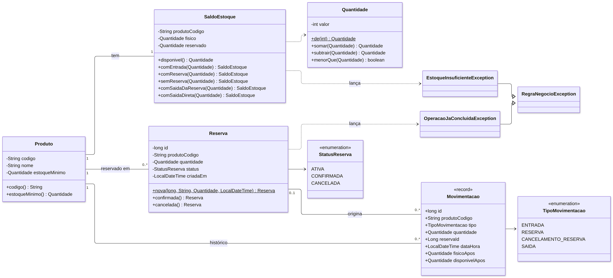
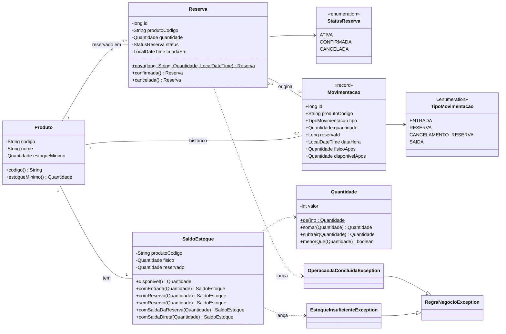
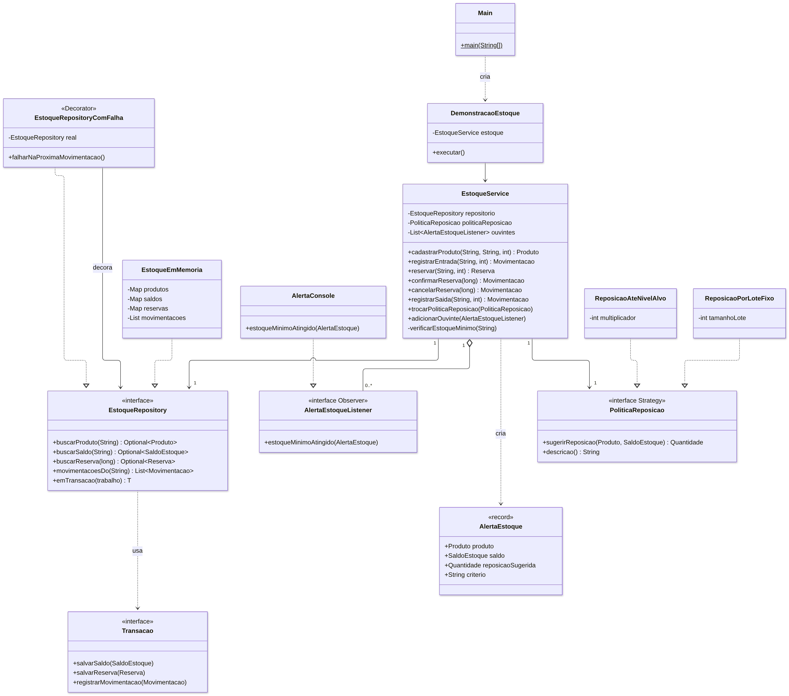
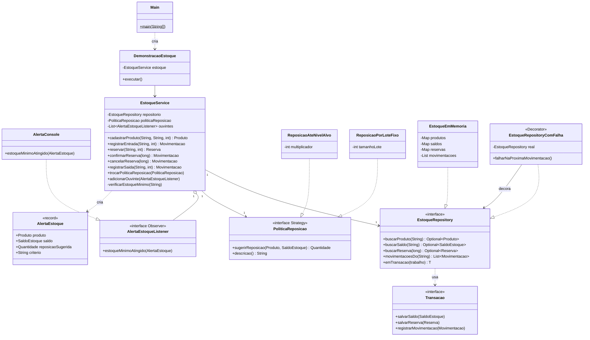

# Diagrama de classes

Classes implementadas em `src/main/java`. Fonte em Mermaid (`.mmd`) e imagem exportada (`.png`).

## 1. Domínio (`model`)

O `SaldoEstoque` separa o estoque físico do reservado; o disponível é físico menos reservado.
A `Reserva` só pode ser confirmada ou cancelada enquanto está ATIVA. Cada operação gera uma `Movimentacao`.

## 2. Serviço, repositório e padrões (`service`, `repository`, `controller`)

| Padrão | Classes | Para quê |
|---|---|---|
| Strategy | `PoliticaReposicao`, `ReposicaoAteNivelAlvo`, `ReposicaoPorLoteFixo` | Critério de reposição substituível |
| Observer | `EstoqueService`, `AlertaEstoqueListener`, `AlertaConsole` | Alerta de estoque mínimo |
| Decorator | `EstoqueRepositoryComFalha` | Simular falha para demonstrar que nada fica gravado pela metade |
